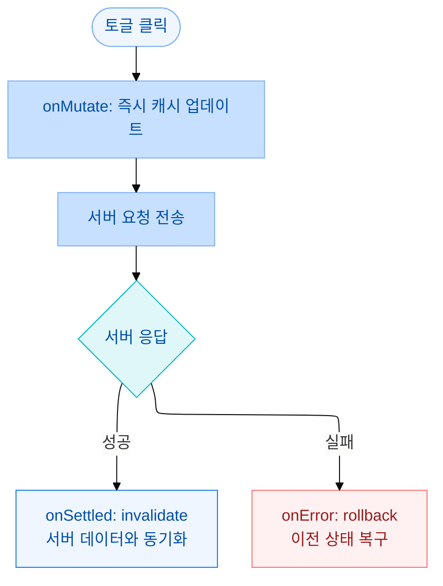

WithTime 프로젝트에서 설정 화면을 개발하면서 토글 버튼의 반응 속도 문제를 고민했습니다.

알람 ON/OFF 토글을 누르면 서버에 요청을 보내고 응답을 받아야 UI가 변합니다.
만약 서버 응답이 300ms라면 토글을 눌렀을 때 0.3초 동안 아무 반응이 없습니다. 이 지연이 사용자에게는 "버튼이 작동하지 않는 것처럼" 느껴집니다.

<BlogImage src="/blog/tanstack-query-optimistic-update/tanstack-query-optimistic-update-01.svg" alt="WithTime 알람 설정 화면 — 알림 항목마다 ON/OFF 토글이 달려 있다" maxWidth="440px" />

## 문제: 요청이 끝나야 UI가 바뀐다

```text
사용자: 토글 ON → 클릭
         ↓
       서버 요청 (300ms)
         ↓
       응답 수신 → setQueryData → UI 업데이트

→ 사용자는 0.3초간 반응 없는 버튼을 보게 된다!
```

알람 설정은 실패할 확률이 낮습니다. 대부분 성공할 것이 거의 확실하기 때문에 서버 응답을 기다려야 할 이유가 없습니다.

## 해결: 낙관적 업데이트(Optimistic Update)

> 서버 응답을 기다리지 않고 UI를 먼저 바꾸는 것이 낙관적 업데이트다. 실패하면 이전 상태로 되돌린다.

```text
사용자: 토글 ON → 클릭
         ↓
   이전 상태 스냅샷 저장 (롤백 대비)
         ↓
   UI 업데이트 (서버 응답 전)
         ↓
   서버에 요청 전송 (백그라운드 진행)
         ↓
    ┌────┴────┐
    ↓         ↓
   성공       실패
    ↓         ↓
서버 값으로    스냅샷으로 롤백
 재동기화     에러 토스트 표시
```

낙관적 업데이트의 판단 기준은 두 가지입니다.

1. 실패 확률이 낮은지
2. 실패해서 되돌렸을 때 사용자가 크게 혼란스럽지 않은지

대체로 좋아요, 북마크, 할 일, 댓글 작성, 드래그 순서 바꾸기 등의 작업에 적절합니다.
결제나 송금, 주문 확정과 같이 실패가 곧 금전적 손해나 신뢰 문제로 이어지는 작업에는 적절하지 않습니다.

## 낙관적 업데이트(Optimistic Update)의 전체 단계

`mutate(postId)`를 호출하면 TanStack Query가 아래 순서로 실행합니다.

```text
mutate(postId) 호출
      ↓
[onMutate]
  1. cancelQueries     진행 중인 쿼리 취소
  2. getQueryData      변경 전 상태 저장
  3. setQueryData      낙관적 상태 업데이트
     return { prev }   저장한 값 넘기기
      ↓
[mutationFn]
  4. 서버 요청
      ↓
[onError]  (실패했을 때만)
  5. 롤백
      ↓
[onSettled]  (성공·실패 모두)
  6. 서버 데이터와 재동기화
```

`useMutation`에 각 시점에 할 일을 함수로 적어 두면, `mutate()`를 한 번 호출하는 것만으로 TanStack Query가 이 순서를 알아서 실행합니다.

```ts
const { mutate } = useMutation({
  onMutate: () => { /* 요청 전에 할 일 */ },
  mutationFn: () => { /* 서버 요청 */ },
  onError: () => { /* 실패하면 할 일 */ },
  onSettled: () => { /* 끝나면 할 일 */ },
});
```

아래 캐시 값을 예시로 각 단계를 살펴보겠습니다.

```ts
// 쿼리 키: ['post', 1]
{ id: 1, liked: false, likeCount: 10 }
```

### 1. 진행 중인 쿼리 취소 — `cancelQueries`

```ts
await queryClient.cancelQueries({ queryKey: ['post', postId] });
```

같은 쿼리 키로 서버에서 데이터를 받아오는 요청(refetch)이 진행 중이라면 취소합니다.

refetch는 생각보다 자주 발생합니다. 화면에 처음 진입할 때, 브라우저 탭으로 다시 돌아왔을 때, 네트워크가 재연결됐을 때 TanStack Query가 자동으로 실행합니다.

취소하지 않으면 아래와 같은 경쟁 상태(race condition)가 발생합니다.

```text
3단계에서 캐시를 { liked: true, likeCount: 11 }로 변경
→ 그 전에 출발한 refetch 응답이 뒤늦게 도착
→ 응답에는 좋아요 전 데이터 { liked: false, likeCount: 10 }이 들어 있음
→ 캐시가 이 값으로 덮어써져 하트가 켜졌다가 꺼짐
```

`await`를 붙여 취소가 완료된 뒤 다음 단계로 넘어갑니다.

### 2. 변경 전 상태 저장 — `getQueryData`

```ts
const prev = queryClient.getQueryData(['post', postId]);
// prev = { id: 1, liked: false, likeCount: 10 }
```

캐시의 현재 값을 변수에 복사해 둡니다. 서버 요청이 실패하면 이 값으로 되돌립니다.

3단계에서 캐시를 덮어쓰고 나면 원래 값은 사라집니다. 덮어쓰기 전에 따로 보관해야 롤백이 가능합니다.

1단계 다음에 저장하는 이유는 정확한 값을 확보하기 위해서입니다. refetch가 진행 중인 상태에서 저장하면, 저장 직후 응답이 도착해 캐시가 변경될 수 있습니다. 그러면 `prev`와 실제 직전 상태가 달라집니다.

### 3. 낙관적 상태 업데이트 — `setQueryData`

```ts
queryClient.setQueryData(['post', postId], (old) => ({
  ...old,
  liked: true,
  likeCount: old.likeCount + 1,
}));
// 캐시 = { id: 1, liked: true, likeCount: 11 }
```

서버 응답을 기다리지 않고 캐시를 직접 수정합니다. 두 번째 인자로 함수를 넘기면 `old`에 현재 캐시 값이 들어오고, 반환한 값이 새 캐시 값이 됩니다.

`useQuery(['post', 1])`로 이 데이터를 사용하는 컴포넌트는 캐시가 변경되면 자동으로 다시 렌더링됩니다. 사용자가 즉시 반응을 확인하는 것은 이 단계 덕분입니다.

`...old`로 기존 값을 복사해 새 객체를 만드는 이유는, `old.liked = true`처럼 기존 객체를 직접 수정하면 TanStack Query가 변경을 감지하지 못해 화면이 다시 그려지지 않기 때문입니다.

### return `{ prev }` — 저장한 값 넘기기

```ts
return { prev };
```

`prev`는 `onMutate` 안의 지역 변수라서 함수가 끝나면 밖에서 참조할 수 없습니다. 롤백은 `onError`에서 처리해야 합니다.

`onMutate`가 반환한 값은 TanStack Query가 보관했다가 `onError`, `onSuccess`, `onSettled`에 `context`라는 이름으로 전달합니다. 이 줄을 빠뜨리면 롤백할 수 없습니다.

### 4. 서버 요청 — `mutationFn`

```ts
mutationFn: (postId) => api.likePost(postId),
```

`onMutate`가 끝나면 실제로 서버에 요청을 전송합니다. 사용자는 이미 바뀐 화면을 보고 있으므로 응답이 늦어도 기다린다고 느끼지 않습니다.

이 함수는 Promise를 반환해야 합니다. Promise가 이행되면 `onSuccess`, 거부되면 `onError`가 호출됩니다.

### 5. 실패 시 롤백 — `onError`

```ts
onError: (error, postId, context) => {
  queryClient.setQueryData(['post', postId], context.prev);
  toast.error('좋아요에 실패했습니다. 다시 시도해 주세요.');
},
```

서버 요청이 실패하면 실행됩니다. 인자는 순서대로 아래와 같습니다.

- `error`: 발생한 에러
- `postId`: `mutate(postId)`에 넘긴 값
- `context`: `onMutate`가 반환한 `{ prev }`

`context.prev`를 캐시에 다시 넣으면 `{ liked: false, likeCount: 10 }`으로 복구되고, 화면의 하트도 꺼집니다. 에러 메시지도 함께 표시해야 합니다. 롤백만 하면 사용자는 하트가 왜 꺼졌는지 알 수 없습니다.

### 6. 서버 데이터와 재동기화 — `onSettled`

```ts
onSettled: (data, error, postId) => {
  queryClient.invalidateQueries({ queryKey: ['post', postId] });
},
```

`onSettled`는 성공과 실패 모두에서 마지막으로 실행됩니다.

`invalidateQueries`는 해당 캐시를 "오래된 데이터"로 표시하고, 화면에서 구독 중이라면 서버에서 다시 가져옵니다.

3단계에서 넣은 값은 클라이언트가 계산한 값입니다. 그 사이 다른 사용자도 좋아요를 눌렀다면 실제 좋아요 수는 11이 아닌 12일 수 있습니다. 서버에서 다시 가져와야 정확한 값이 됩니다. 실패해서 롤백한 경우에도 서버 기준으로 다시 확인합니다.

`onSuccess`에서 응답값으로 `setQueryData`를 해도 되지만, `onSettled`에서 `invalidateQueries`를 하면 성공과 실패를 한 곳에서 처리할 수 있어 더 일반적입니다.

### 전체 코드

```ts
const queryClient = useQueryClient();

const { mutate } = useMutation({
  // 4. 서버 요청
  mutationFn: (postId) => api.likePost(postId),

  onMutate: async (postId) => {
    // 1. 진행 중인 쿼리 취소
    await queryClient.cancelQueries({ queryKey: ['post', postId] });

    // 2. 변경 전 상태 저장
    const prev = queryClient.getQueryData(['post', postId]);

    // 3. 낙관적 상태 업데이트
    queryClient.setQueryData(['post', postId], (old) => ({
      ...old,
      liked: true,
      likeCount: old.likeCount + 1,
    }));

    // 저장한 값을 context로 넘기기
    return { prev };
  },

  // 5. 실패 시 롤백
  onError: (error, postId, context) => {
    queryClient.setQueryData(['post', postId], context.prev);
    toast.error('좋아요에 실패했습니다. 다시 시도해 주세요.');
  },

  // 6. 서버 데이터와 재동기화
  onSettled: (data, error, postId) => {
    queryClient.invalidateQueries({ queryKey: ['post', postId] });
  },
});
```

### 캐시 값 변화로 다시 보기

```text
처음              { liked: false, likeCount: 10 }
1. 취소           { liked: false, likeCount: 10 }   (값 그대로, 외부 변경만 막음)
2. 저장           prev = { liked: false, likeCount: 10 }
3. 업데이트       { liked: true,  likeCount: 11 }   ← 화면 즉시 변경
4. 서버 요청      { liked: true,  likeCount: 11 }   (응답 대기 중에도 유지)

성공한 경우
6. 재동기화       { liked: true,  likeCount: 12 }   (서버의 실제 값)

실패한 경우
5. 롤백           { liked: false, likeCount: 10 }   ← prev로 복구
6. 재동기화       { liked: false, likeCount: 10 }   (서버 값 확인)
```

### WithTime 알람 토글에 적용하기

알람 설정은 실패 확률이 낮고 롤백해도 사용자가 혼란스럽지 않습니다. 낙관적 업데이트를 적용하기에 적합한 케이스입니다.

`onMutate`에서 서버 요청 전에 즉시 캐시를 업데이트하고, `onError`에서 실패 시 이전 상태로 복구합니다.

```ts
// src/hooks/settingAlarm/useAlarms.ts
export function useToggleAlarm() {
  const qc = useQueryClient();

  return useCoreMutation({
    mutationFn: ({ alarmId, enabled }: { alarmId: number; enabled: boolean }) =>
      toggleAlarm(alarmId, enabled),

    onMutate: async ({ alarmId, enabled }) => {
      // 진행 중인 refetch가 낙관적 업데이트를 덮어쓰지 않도록 취소
      await qc.cancelQueries({ queryKey: alarmKeys.all });

      // 롤백을 위해 현재 상태 저장
      const prev = qc.getQueryData(alarmKeys.list());

      // 즉시 UI 업데이트
      qc.setQueryData(alarmKeys.list(), (old: AlarmItem[] | undefined) =>
        old?.map((a) => (a.id === alarmId ? { ...a, enabled } : a)),
      );

      return { prev }; // onError에서 롤백에 사용
    },

    onError: (_err, _vars, ctx) => {
      // 에러 시 저장해둔 이전 상태로 복구
      if (ctx?.prev) qc.setQueryData(alarmKeys.list(), ctx.prev);
    },

    onSettled: () => {
      // 성공·실패 무관하게 서버 실제 데이터와 동기화
      void qc.invalidateQueries({ queryKey: alarmKeys.all });
    },
  });
}
```

컴포넌트에서는 뮤테이션을 호출하기만 하면 됩니다.

```tsx
// src/components/settingTab/AlarmSetting.tsx
function AlarmSetting() {
  const { data: alarms } = useAlarms();
  const { mutate: toggleAlarm } = useToggleAlarm();

  return (
    <>
      {alarms?.map((alarm) => (
        <div key={alarm.id} className="flex items-center justify-between">
          <span>{alarm.label}</span>
          <ToggleSwitch
            checked={alarm.enabled}
            onChange={(enabled) => toggleAlarm({ alarmId: alarm.id, enabled })}
          />
        </div>
      ))}
    </>
  );
}
```

## 세 단계의 역할

### `onMutate` — 낙관적 업데이트

서버 요청이 시작되기 직전에 호출됩니다. 첫째, `cancelQueries`로 진행 중인 refetch를 취소합니다. 낙관적 업데이트 직후에 refetch 응답이 도착하면 업데이트가 덮어씌워질 수 있기 때문입니다.

둘째, `setQueryData`로 즉시 캐시를 업데이트합니다. 이 시점에 UI가 바뀝니다.

### `onError` — 롤백

서버 요청이 실패하면 `onMutate`에서 반환한 `ctx`를 받아 이전 상태로 복구합니다. 사용자가 토글을 ON으로 바꿨는데 서버가 실패하면, 토글이 다시 OFF로 돌아갑니다.

### `onSettled` — 동기화

성공이든 실패든 최종적으로 서버 데이터를 다시 조회합니다. 낙관적 업데이트는 "즉시 반응"을 위한 것이고, 실제 진실의 원천은 서버입니다.

## 결과



토글을 누르는 순간 즉시 반응합니다. 네트워크 지연이 있어도 사용자에게는 빠른 앱처럼 느껴집니다.

## 배운 것

Optimistic Update는 단순히 UI를 빠르게 보여주는 것을 넘어서 '좋아요'나 '삭제'처럼 결과가 거의 확실한 작업에서 지연 없는 사용자 경험을 만드는 강력한 도구입니다.
이번 WithTime 프로젝트를 통해 UX 관점에서 "즉시 반응"과 "데이터 정확성"을 동시에 잡으려면 낙관적 업데이트가 적합한 상황인지 먼저 판단해야 한다는 것을 배웠습니다.

| 판단 기준 | 적합한 작업 | 적합하지 않은 작업 |
| --- | --- | --- |
| 실패 확률이 낮다 | 토글, 좋아요, 북마크 | 결제, 송금, 주문 확정 |
| 롤백해도 혼란스럽지 않다 | 할 일, 드래그 순서 | 금전 거래, 계정 삭제 |
