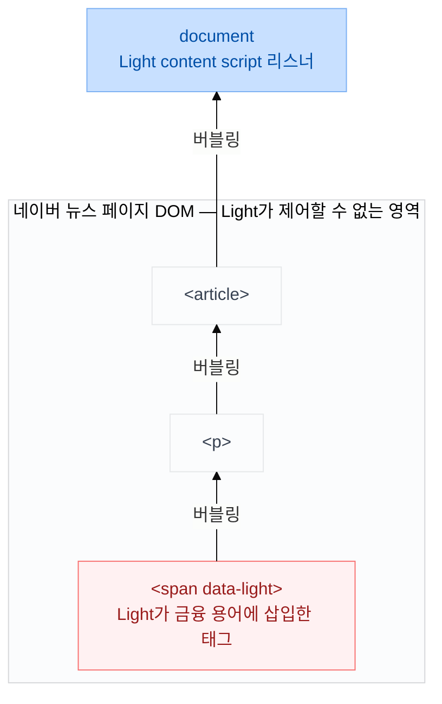

## 1. 전제 상황과 직면한 문제

Light는 경제 뉴스 속 금융 용어를 자동 감지해 툴팁으로 보여주는 Chrome 확장 프로그램입니다. 사용자가 뉴스 페이지를 열면 content script가 실행되고, `TreeWalker`로 기사 텍스트를 순회하면서 금융 용어를 찾아 해당 텍스트를 <TermAnnotation def="Light가 금융 용어를 발견했을 때 해당 텍스트를 감싸기 위해 직접 삽입하는 HTML 태그입니다. 이 속성값이 용어를 식별하는 키가 됩니다.">`<span data-light>`</TermAnnotation> 태그로 직접 감쌉니다.

이 동작 방식 때문에 이벤트 처리를 설계할 때 세 가지 제약이 동시에 걸렸습니다.

### (1) 시점의 문제: 로드 시점에 span이 존재하지 않는다

페이지가 처음 로드될 때는 `<span data-light>`이 아예 없습니다. Light content script가 실행되면서 뒤늦게 만들어지기 때문에, 처음부터 `querySelectorAll('[data-light]')`로 찾아 리스너를 붙여두는 방법 자체가 불가능합니다. 그렇다고 span이 생길 때마다 리스너를 추가하면 span 개수만큼 리스너가 쌓입니다.

### (2) 컨테이너 부재: 공통 부모가 없다

내가 만든 단독 웹앱이라면 `<div id="app">` 아래 요소들만 감시하면 됩니다. 하지만 Light는 타사 사이트(네이버 뉴스 등)에서 동작합니다. 기사 본문, 사이드바 등 페이지 전체에 흩어진 span들을 아우르는 공통 부모가 없습니다. 리스너를 달 수 있는 유일한 공통 지점은 `document`입니다.

### (3) 성능 부담: 개별 리스너 부착은 타사 페이지에도 악영향

기사 하나에 금융 용어가 50개라면, 50개의 span에 각각 마우스 이벤트 리스너를 붙이는 것은 브라우저 성능에 부담을 줍니다. 네이버 뉴스가 내부적으로 달아둔 리스너까지 합치면 부담은 더 커집니다.

## 2. 해결책: 이벤트 위임과 document 단일 리스너

### 이벤트 버블링 원리

세 제약을 한 번에 해결하는 정석 패턴이 **이벤트 위임**(Event Delegation)입니다.

DOM의 모든 이벤트는 자식 요소에서 발생한 뒤, 부모 요소를 타고 최상단인 `document`까지 거슬러 올라갑니다. 이를 **이벤트 버블링**이라고 합니다.



### 리스너 최소화 설계

개별 `<span>`마다 리스너를 50개 달 필요 없이, `document`에 딱 2개의 리스너(`mouseover`, `mouseout`)만 등록하면 됩니다. 사용자가 어떤 span에 마우스를 올리든 그 이벤트는 버블링을 통해 결국 `document`까지 전달되므로, 놓치지 않고 감지할 수 있습니다.

```js
document.addEventListener('mouseover', (e) => {
  if (!e.target.matches('[data-light]')) return

  showTooltip(e.target)
})

document.addEventListener('mouseout', () => {
  hideTooltip()
})
```

span이 나중에 새로 생겨도 문제가 없습니다. 리스너가 개별 span이 아니라 `document`에 있기 때문에, 새로 추가된 span에서 발생한 이벤트도 버블링을 통해 그대로 잡힙니다. 리스너 개수는 span이 몇 개든 항상 2개로 고정됩니다.

처음에는 `mouseenter`/`mouseleave`를 고려했습니다. 이 이벤트는 요소 안으로 진입·이탈할 때 정확히 한 번씩 발생해서 연속 발화 문제가 없습니다. 그런데 `mouseenter`와 `mouseleave`는 **버블링하지 않습니다**. 이벤트 위임의 핵심은 버블링이므로, 버블링이 없는 이벤트로는 위임이 불가능합니다.

| 이벤트 | 버블링 | document 위임 가능 |
| --- | --- | --- |
| `mouseover` / `mouseout` | O | O |
| `mouseenter` / `mouseleave` | X | X |

Light는 공통 부모 컨테이너 없이 `document`에서 위임해야 하므로 버블링하는 `mouseover`/`mouseout`을 선택했습니다. 연속 발화 문제는 디바운싱으로 별도 해결합니다.

## 3. 구현 과정에서 마주친 예외 상황과 해결 전략

### ① 자식 요소가 포함된 경우: `closest()` 활용

`<span data-light>` 내부에 `<strong>PER</strong>` 같은 자식 태그가 있으면, 마우스를 올렸을 때 이벤트의 출발점(`e.target`)이 span이 아니라 `strong`이 됩니다.

```text
<span data-light>
  "삼성전자 "
  <strong>PER</strong>  ← 여기에 마우스를 올리면 e.target은 span이 아닌 strong
</span>
```

`e.target.matches('[data-light]')`를 쓰면 `e.target`이 `strong`일 때 조건을 통과하지 못합니다. 대신 [`e.target.closest('[data-light]')`](https://developer.mozilla.org/en-US/docs/Web/API/Element/closest)는 호버된 요소로부터 부모 방향으로 거슬러 올라가며 `[data-light]` 속성을 가진 첫 번째 요소를 찾아냅니다.

```js
document.addEventListener('mouseover', (e) => {
  const span = e.target.closest('[data-light]')
  if (!span) return

  showTooltip(span) // 자식 요소를 호버해도 부모 span을 찾아 처리
})
```

### ② 빠른 마우스 이동으로 인한 깜빡임: 디바운싱

기사를 가로질러 마우스를 빠르게 움직이면 수많은 `mouseover` 이벤트가 연달아 발생합니다. 여러 span을 스치며 지나갈 때마다 툴팁이 깜빡이고, 불필요한 API 요청도 일어납니다.

`setTimeout`과 `clearTimeout`을 이용해, 마우스가 멈춘 지 150ms가 지났을 때만 툴팁을 띄우는 **디바운싱**(Debouncing)을 적용합니다.

```text
빠른 마우스 이동:
mouseover → mouseover → mouseover → [150ms 경과] → showTooltip()
[timer 초기화]  [timer 초기화]  [timer 시작]
```

150ms 동안 새 `mouseover`가 발생하지 않을 때만 `showTooltip()`이 실행됩니다.

```js
let timer = null

document.addEventListener('mouseover', (e) => {
  const span = e.target.closest('[data-light]')
  if (!span) return

  clearTimeout(timer)
  timer = setTimeout(() => {
    showTooltip(span)
  }, 150)
})

document.addEventListener('mouseout', (e) => {
  const span = e.target.closest('[data-light]')
  if (!span) return

  clearTimeout(timer)
  hideTooltip()
})
```

150ms는 여러 번 테스트하면서 정한 값입니다. 너무 짧으면 스쳐 지나가는 마우스에도 반응하고, 너무 길면 툴팁이 느리게 뜬다고 느껴졌기 때문입니다.

<Callout type="tip">
content script가 언로드되거나 페이지가 전환될 때 `document`에 붙인 리스너가 남아 있으면 메모리 누수가 발생할 수 있습니다. `chrome.runtime.onMessage`로 언로드 시점을 감지하거나, MutationObserver를 해제하는 시점에 `document.removeEventListener`로 리스너를 함께 정리합니다.
</Callout>

### ③ 타사 페이지와의 스타일 충돌: Shadow DOM 격리

툴팁 UI를 일반 HTML로 만들면, 네이버 뉴스의 전역 CSS가 툴팁 스타일을 망가뜨리거나, 반대로 Light가 삽입한 CSS가 뉴스 페이지 레이아웃을 건드릴 수 있습니다. 이벤트는 일반 DOM에서 잡지만, 툴팁 UI는 Shadow DOM 안에서 렌더링해 이 문제를 해결합니다.

Shadow DOM은 일반 DOM 요소에 붙일 수 있는 **격리된 DOM 트리**입니다. Shadow Root 안의 스타일은 외부로 새어 나가지 않고, 외부 CSS 선택자도 안으로 침투할 수 없습니다. 브라우저가 내장 컴포넌트(`<video>`, `<input type="range">` 등)의 스타일을 보호할 때도 같은 메커니즘을 사용합니다.

Light는 페이지 `<body>`에 `<div id="light-extension-root">`를 하나 삽입하고, 그 안에 Shadow Root를 붙입니다. 툴팁 컴포넌트(`TooltipLayer`)는 이 Shadow Root 안에 React로 렌더링됩니다. `document` 리스너가 span `mouseover`를 감지하면 Shadow Root 안의 React 상태를 업데이트해 툴팁이 표시됩니다. 네이버 뉴스의 전역 CSS가 아무리 복잡해도 툴팁 스타일에 영향을 줄 수 없고, Light가 삽입한 CSS가 뉴스 페이지 레이아웃을 건드리지도 않습니다.

## 4. 핵심 요약

| 제약 | 해결 |
| --- | --- |
| span이 동적으로 생성된다 | 생성 시점 리스너를 달지 않고 `document` 위임 |
| 공통 부모 컨테이너가 없다 | `document` 레벨에서 위임 |
| 타사 페이지 성능 영향 최소화 | 리스너를 2개로 고정 |
| 자식 요소 호버 시 target 불일치 | `closest()`로 부모 방향 탐색 |
| 마우스가 빠르게 지나갈 때 | 150ms 디바운싱 |
| 타사 페이지 CSS 충돌 | Shadow DOM으로 UI 격리 |

> 동적으로 생기는 수많은 요소에 직접 리스너를 달지 않고, 최상단 `document`에서 버블링을 이용해 이벤트를 가로챈 뒤(`closest`), 디바운싱으로 최적화하고, UI는 Shadow DOM으로 격리한다.

이 흐름으로 코드를 작성하면 타사 페이지의 구조를 몰라도 안전하고 가볍게 확장 프로그램을 동작시킬 수 있습니다.

**MDN 참고**
- [`Element.closest()`](https://developer.mozilla.org/en-US/docs/Web/API/Element/closest)
- [`TreeWalker`](https://developer.mozilla.org/en-US/docs/Web/API/TreeWalker)
- [Shadow DOM 사용하기](https://developer.mozilla.org/en-US/docs/Web/API/Web_components/Using_shadow_DOM)
