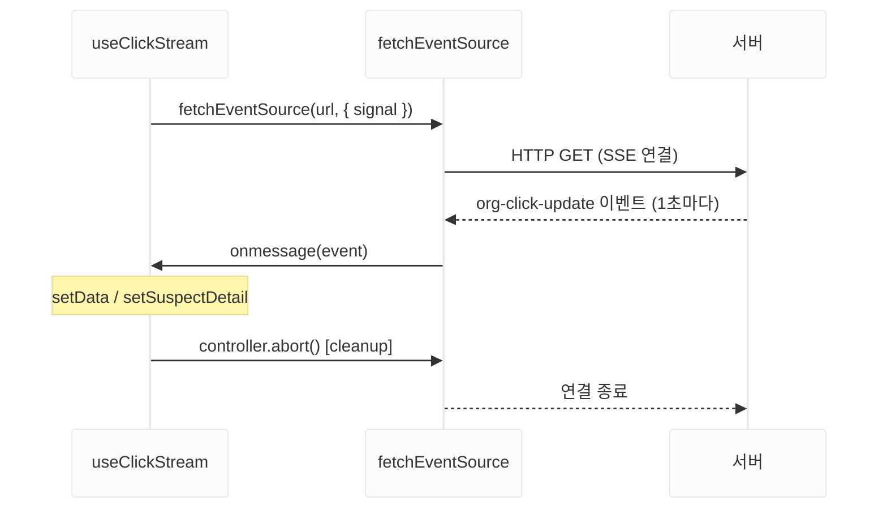

WhereYouAd 대시보드에서 광고 클릭 스트림을 실시간으로 표시해야 했습니다. 데이터 업데이트 주기는 1초, 서버에서 클라이언트 방향으로만 데이터가 흐르는 구조입니다.

처음에는 `setInterval`로 1초마다 폴링하는 방식을 검토했습니다. 하지만 데이터 변화 여부와 상관없이 반복 요청이 발생해 불필요한 서버 부하가 생깁니다. 서버 → 클라이언트 단방향 스트리밍이 필요한 상황이라 SSE를 선택했습니다.

## Polling, WebSocket, SSE 비교

실시간 데이터를 받아오는 방법은 세 가지입니다.

| | Polling | WebSocket | SSE |
|---|---|---|---|
| 통신 방향 | 클라이언트 → 서버 반복 | 양방향 | 서버 → 클라이언트 |
| 연결 방식 | 요청마다 새 HTTP 연결 | 별도 프로토콜 (ws://) | HTTP 단일 연결 유지 |
| 실시간성 | 주기 간격만큼 지연 | ✅ | ✅ |
| 자동 재연결 | 해당 없음 | 직접 구현 | ✅ (브라우저 기본) |

클릭 스트림은 클라이언트가 서버로 데이터를 보낼 일이 없으므로, 양방향 통신이 가능한 WebSocket은 이 상황에서 불필요합니다. SSE는 기존 HTTP를 그대로 사용해 인프라 변경 없이 적용할 수 있다는 점도 선택 이유였습니다.

## EventSource, EventSourcePolyfill, FetchEventSource

SSE를 구현하는 방법은 세 가지입니다.

### EventSource

[`EventSource`](https://developer.mozilla.org/ko/docs/Web/API/EventSource)는 브라우저 기본 Web API입니다.

```ts
const es = new EventSource(url, { withCredentials: true });
es.addEventListener("message", (event) => {
  const data = JSON.parse(event.data);
});
```

연결이 끊기면 자동으로 재연결하고 이벤트 리스너를 쉽게 붙일 수 있습니다. 하지만 **커스텀 헤더를 지원하지 않습니다.** `withCredentials`로 쿠키 전송은 가능하지만, [`Authorization`](https://developer.mozilla.org/ko/docs/Web/HTTP/Headers/Authorization) 헤더를 추가할 방법이 없어 JWT 인증이 필요한 엔드포인트에는 쓸 수 없습니다.

### EventSourcePolyfill

`event-source-polyfill` 라이브러리입니다. `EventSource`와 동일한 API를 유지하면서 커스텀 헤더를 추가할 수 있습니다.

```ts
import { EventSourcePolyfill } from "event-source-polyfill";

const es = new EventSourcePolyfill(url, {
  headers: { Authorization: `Bearer ${token}` },
  withCredentials: true,
});
```

GET 메서드 기반에서 JWT 인증 헤더가 필요한 경우에 적합합니다. POST 메서드나 Request Body 전송은 지원하지 않습니다.

### FetchEventSource

Microsoft가 공개한 오픈소스 라이브러리입니다. `fetch` 기반이라 커스텀 헤더, POST Body, 세밀한 에러 핸들링을 모두 지원합니다.

```ts
import { fetchEventSource } from "@microsoft/fetch-event-source";

await fetchEventSource(url, {
  headers: { Authorization: `Bearer ${token}` },
  async onopen(response) {
    if (response.status === 401) { /* 재발급 처리 */ }
  },
  onmessage(event) { /* 데이터 처리 */ },
  onerror(err) { /* 에러 처리 */ },
});
```

`onopen`, `onerror` 훅에서 연결 성공/실패를 직접 제어할 수 있습니다. 자동 재연결은 직접 구현해야 하지만, 인증 처리나 에러 상황에 맞게 다루기 더 좋습니다.

| | EventSource | EventSourcePolyfill | FetchEventSource |
|---|:-----------:|:-------------------:|:----------------:|
| 커스텀 헤더 | ❌ | ✅ | ✅ |
| POST 지원 | ❌ | ❌ | ✅ |
| 자동 재연결 | ✅ | ✅ | 직접 구현 |
| 세밀한 에러 핸들링 | ❌ | ❌ | ✅ |

JWT 인증 헤더가 필요하고 나중에 401 재발급 처리까지 붙여야 했기 때문에 FetchEventSource를 선택했습니다.

## useClickStream — SSE 연결 캡슐화

FetchEventSource를 직접 컴포넌트에서 쓰면 연결 생명주기와 상태 관리가 얽힙니다. SSE 연결 전체를 `useClickStream` 훅으로 캡슐화했습니다.



```ts
import { fetchEventSource } from "@microsoft/fetch-event-source";
import useAuthStore from "@/store/useAuthStore";
import useWorkspaceStore from "@/store/useWorkspaceStore";

export function useClickStream(mode: "real" | "dummy" = "real") {
  const orgId = useWorkspaceStore((s) => s.selectedOrgId);
  const accessToken = useAuthStore((s) => s.accessToken);

  const [data, setData] = useState<IClickStreamItem | null>(null);
  const [suspectDetail, setSuspectDetail] =
    useState<IClickStreamItem["suspectDetail"]>(null);

  useEffect(() => {
    if (!orgId || !accessToken) return;

    const controller = new AbortController();

    fetchEventSource(`/api/dashboard/${orgId}/clicks/stream?mode=${mode}`, {
      headers: { Authorization: `Bearer ${accessToken}` },
      signal: controller.signal,
      onmessage(event) {
        if (event.event === "org-click-update") {
          const parsed: IClickStreamItem = JSON.parse(event.data)?.data;
          setData(parsed);
          if (parsed.suspectDetail) {
            setSuspectDetail(parsed.suspectDetail);
          }
        }
      },
    });

    return () => controller.abort();
  }, [orgId, accessToken, mode]);

  return { data, suspectDetail };
}
```

훅의 실행은 두 경로로 나뉩니다. 왼쪽은 이벤트를 수신해 state를 업데이트하는 경로이고, 오른쪽은 unmount 시 연결을 끊는 cleanup 경로입니다.


설계에서 짚어둘 포인트가 두 가지 있습니다.

`data`는 매 tick(1초)마다 완전히 교체되지만, `suspectDetail`은 **별도 state로 분리**해 보존합니다. 이상 징후는 한 번 감지된 뒤 사용자가 확인할 때까지 계속 표시해야 하므로, 새 데이터가 와도 초기화되지 않아야 합니다.

`accessToken`은 `useEffect` 의존성에 포함됩니다. 토큰이 변경되면 `useEffect`가 재실행되어 새 연결을 맺으므로, 401 재발급으로 `accessToken`이 바뀌면 **자동으로 새 연결**로 이어집니다.

## 개발 환경에서 연결이 두 번 되는 이유

React 18 `StrictMode`가 개발 환경에서 effect를 의도적으로 두 번 실행하기 때문입니다(mount → unmount → mount). DevTools Network 탭에서 SSE 연결이 두 번 맺어지는 것을 확인할 수 있습니다.


첫 번째 연결은 unmount 시 [`AbortController`](https://developer.mozilla.org/ko/docs/Web/API/AbortController)의 `abort()`로 취소됩니다. Network 탭에서 빨간색으로 표시되는 건 이 abort로 인한 정상 종료이며, 프로덕션 빌드에서는 effect가 한 번만 실행됩니다.

## 정리

JWT 인증 헤더가 필요한 SSE에는 `EventSource`를 쓸 수 없습니다. `FetchEventSource`는 `onopen`과 `onerror` 훅으로 인증 처리와 에러 핸들링을 직접 제어할 수 있어, 이후 401 재발급 로직을 추가할 때 확장하기 좋은 구조입니다.

> SSE는 axios 인터셉터를 거치지 않아, accessToken이 만료됐을 때 재발급을 1번으로 보장하는 문제가 별도로 남습니다.
