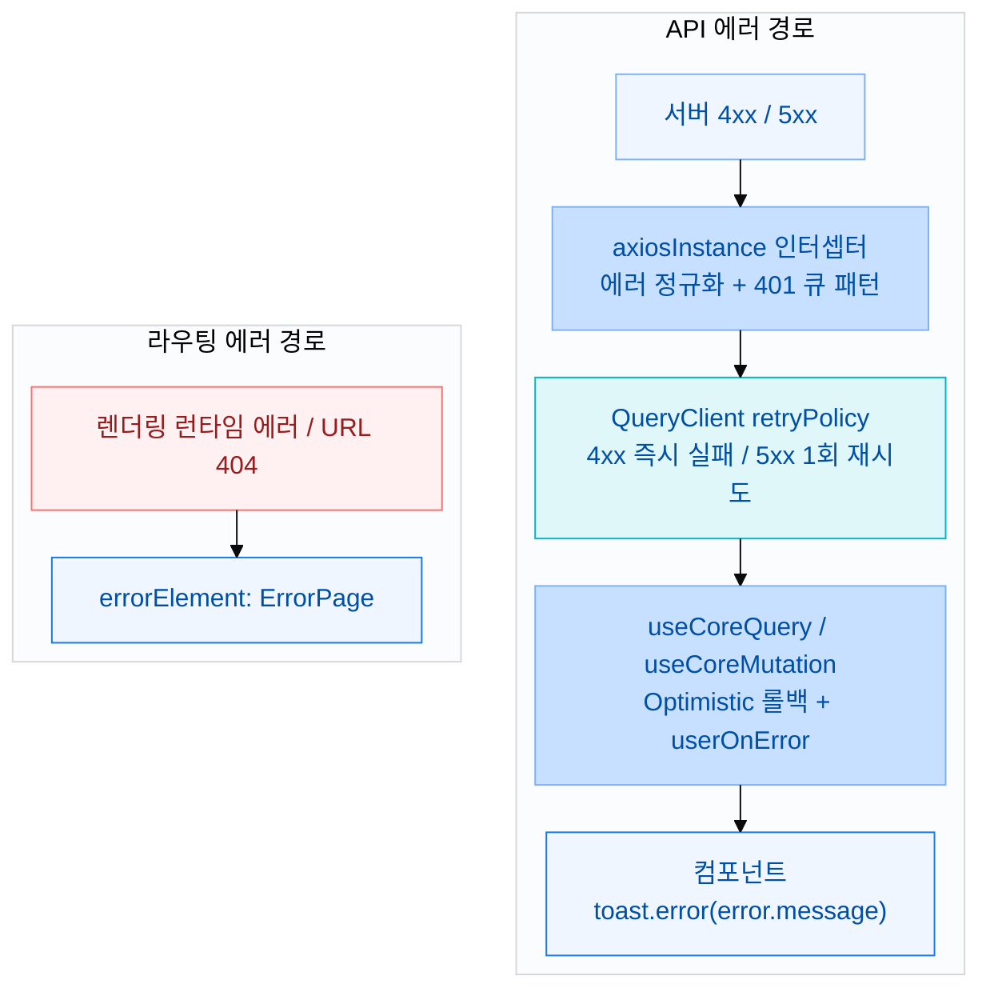
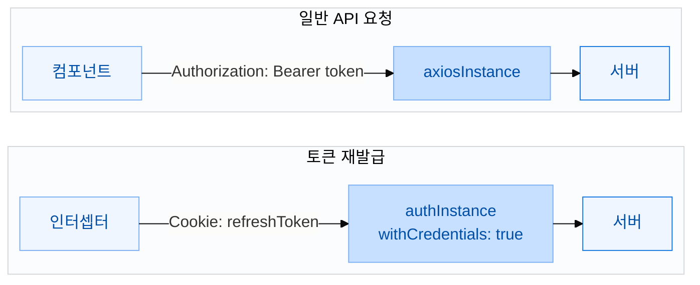
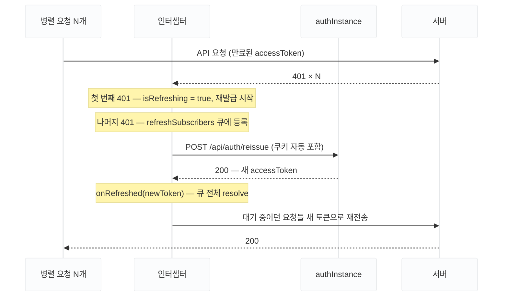

> 병렬 401부터 라우트 에러 경계까지 — WhereYouAd에서 실제로 적용한 5단계 구조

## 에러 처리 구조가 필요해진 이유

사이드 프로젝트에서 흔히 볼 수 있는 에러 처리 코드는 이런 모습입니다.

```ts
// 컴포넌트 안에서
try {
  await deleteUser(id);
} catch (err: any) {
  if (err.response?.status === 401) {
    router.push("/login");
  } else {
    toast.error(err.response?.data?.message ?? "오류가 발생했습니다.");
  }
}
```

잘못된 코드는 아닙니다. 하지만 API가 30개가 넘어가면 문제가 생기기 시작합니다.

- `err.response?.data?.message`를 매번 중첩 접근해야 합니다
- 401 처리 로직이 컴포넌트 곳곳에 흩어집니다
- TanStack Query를 쓴다면 `error` 타입이 `unknown`이라 매번 타입 단언이 필요합니다
- 대시보드 진입 시 API 6개가 동시에 날아가다가 전부 401을 받으면 토큰 재발급이 6번 일어납니다

마지막 문제가 특히 치명적이었습니다. DevTools Network 탭을 열어보니 `/api/auth/reissue`가 9번 호출되고 있었는데, refreshToken은 1회용이라 두 번째 재발급 요청부터 모두 실패했습니다.

이 글은 WhereYouAd 프로젝트에서 이 문제들을 해결하면서 정착한 5레이어 에러 처리 구조를 정리한 것입니다.

## 전체 구조 한눈에 보기

API 에러와 렌더링 에러, 두 경로가 각각의 레이어를 거쳐 처리됩니다.



각 레이어가 한 가지 역할만 담당합니다. 컴포넌트는 `error.message`를 toast에 넘기기만 하면 됩니다.

## 1. 에러 타입 정규화

모든 에러 처리의 출발점입니다.

```ts
// src/types/common/common.ts
export interface IApiErrorResponse {
  status: string;      // "Unauthorized"
  code: string;        // "AUTH_401_3"
  message: string;     // "잘못된 토큰 형식입니다." — 한국어로 바로 표시 가능
  method: string;      // "DELETE"
  requestURI: string;  // "/api/users/my"
}
```

백엔드에서 이 형식으로 에러 응답이 내려왔고, 그대로 타입으로 정의해 사용했습니다. `message`가 한국어로 내려왔기 때문에 프론트에서 별도 메시지 매핑 없이 `error.message`를 toast에 바로 넘길 수 있었습니다.

에러 응답 구조가 프론트 처리 전체에 영향을 미치는 만큼, 다음 프로젝트에서는 초기에 에러 스키마를 맞춰두는 것이 좋겠다고 생각합니다.

```ts
// ❌ 이렇게 하지 않아도 된다
const ERROR_MESSAGES: Record<string, string> = {
  USER_400_9: "조직 소유권 양도를 진행한 후 탈퇴를 시도해주세요",
  AUTH_401_3: "잘못된 토큰 형식입니다.",
  ...
};

// ✅ 이것만으로 충분하다
toast.error(error.message ?? "요청에 실패했습니다.");
```

UX 분기가 필요한 경우에만 `error.code`로 분기하고, 메시지는 여전히 백엔드에서 받은 것을 그대로 씁니다.

```ts
userOnError: (error) => {
  if (error.code === "USER_400_9") {
    navigate("/workspace/transfer");
    return;
  }
  toast.error(error.message ?? "요청에 실패했습니다.");
},
```

## 2. axiosInstance 인터셉터

### 인스턴스를 두 개 쓰는 이유

이 프로젝트에서는 axios 인스턴스를 두 개 만들어 역할을 분리했습니다.

```ts
// 일반 API 요청 — Authorization 헤더 자동 주입
export const axiosInstance = axios.create({ baseURL: BASE_URL });

// 토큰 재발급 전용 — httpOnly 쿠키를 함께 보내야 함
export const authInstance = axios.create({
  baseURL: BASE_URL,
  withCredentials: true,
});
```



**일반 API 요청**: `axiosInstance`는 요청 인터셉터에서 `Authorization: Bearer {accessToken}` 헤더를 자동으로 주입합니다. accessToken은 메모리(Zustand store)에 저장하기 때문에 JavaScript에서 직접 꺼내 헤더에 담습니다.

**토큰 재발급 요청**: refreshToken은 XSS 방어를 위해 [`Set-Cookie`](https://developer.mozilla.org/ko/docs/Web/HTTP/Headers/Set-Cookie) 응답 헤더의 `HttpOnly` 속성으로 브라우저에 저장합니다. `HttpOnly`가 붙은 쿠키는 `document.cookie`로 읽을 수 없어서, XSS 공격으로 악성 스크립트가 실행되어도 refreshToken을 탈취하지 못합니다.

브라우저는 같은 도메인으로 요청을 보낼 때 쿠키를 자동으로 실어 보내지만, **크로스 오리진 요청에는 기본적으로 쿠키를 포함시키지 않습니다.** `withCredentials: true`를 설정해야 크로스 오리진 요청에서도 브라우저가 쿠키를 포함시킵니다.

재발급 요청에만 이 설정이 필요하므로 인스턴스를 분리했습니다. `axiosInstance`에 `withCredentials: true`를 달면 모든 API 요청에 쿠키가 붙어 불필요한 쿠키 노출이 생깁니다.

### 에러 정규화

axios 기본 에러는 `AxiosError` 래퍼 안에 서버 데이터가 들어있어서 `err.response?.data?.message`처럼 중첩 접근이 필요합니다. 인터셉터에서 한 번 꺼내 reject하면 이후 모든 레이어가 `error.message`로 바로 접근할 수 있습니다.

```ts
axiosInstance.interceptors.response.use(
  (response) => response,
  (error: AxiosError) => {
    // ... 401 처리
    return Promise.reject((error.response?.data as IApiErrorResponse) ?? error);
  }
);
```

### 401 큐 패턴

대시보드 진입 시 API 요청이 동시에 여러 개 날아갑니다. accessToken이 만료됐다면 이 요청들이 전부 401을 받습니다. 각 요청이 각자 재발급을 시도하면 `/api/auth/reissue`가 N번 호출됩니다.

**첫 번째 401만 재발급을 실행**하고, 나머지는 그 결과를 기다리게 합니다.



```ts
let isRefreshing = false;
let refreshSubscribers: Array<{
  resolve: (token: string) => void;
  reject: (error: unknown) => void;
}> = [];
```

401이 들어왔을 때 분기:

```ts
if (error.response?.status === 401) {

  // accessToken 자체가 없으면 재발급 근거 없음 → 바로 실패
  if (!useAuthStore.getState().accessToken) {
    return Promise.reject((error.response?.data as IApiErrorResponse) ?? error);
  }

  // 이미 재발급 중 → 큐에 등록하고 대기
  if (isRefreshing) {
    return new Promise((resolve, reject) => {
      addRefreshSubscriber(
        (newToken) => {
          originalRequest.headers.Authorization = `Bearer ${newToken}`;
          resolve(axiosInstance(originalRequest));  // 새 토큰으로 자동 재전송
        },
        (err) => reject(err),
      );
    });
  }

  // 재발급 요청 자체가 401이면 → 로그아웃
  if (originalRequest.url?.includes("/api/auth/reissue") || originalRequest._retry) {
    useAuthStore.getState().logout();
    return Promise.reject(error);
  }

  // 첫 번째 401 → 재발급 실행
  originalRequest._retry = true;
  isRefreshing = true;

  try {
    const { data } = await authInstance.post("/api/auth/reissue");
    const newToken = data.data?.accessToken;

    useAuthStore.getState().setAccessToken(newToken);
    onRefreshed(newToken);  // 큐에 대기 중인 모든 요청에 새 토큰 전달

    originalRequest.headers.Authorization = `Bearer ${newToken}`;
    return axiosInstance(originalRequest);
  } catch {
    onRefreshFailed(error);  // 큐 전체 reject
    useAuthStore.getState().logout();
    return Promise.reject(error);
  } finally {
    isRefreshing = false;
    refreshSubscribers = [];
  }
}
```

이 구조로 바꾸고 나서 9번이던 재발급 호출이 1번으로 줄었습니다.

<Callout type="warning">
`accessToken`을 쿼리 키에 포함하면 재발급 후 캐시 키가 바뀌어 캐시 히트율이 0%가 됩니다. 키에는 `orgId` 같이 변하지 않는 식별자를 쓰는 것이 좋습니다.
</Callout>

## 3. QueryClient retry 전략

TanStack Query의 기본 retry 횟수는 3번입니다. 401, 403, 404 같은 클라이언트 에러에 3번 재시도하는 것은 의미가 없습니다.

```ts
// src/lib/queryClient.ts
const retryPolicy = (failureCount: number, error: unknown): boolean => {
  const status = Number((error as IApiErrorResponse)?.status);
  if (Number.isFinite(status) && status >= 400 && status < 500) return false;
  return failureCount < 1;
};
```

| HTTP 상태 | 재시도 | 이유 |
|-----------|:------:|------|
| 400 Bad Request | ❌ | 요청 형식 오류 — 재시도해도 동일 결과 |
| 401 Unauthorized | ❌ | 인터셉터에서 이미 처리 — 중복 개입 방지 |
| 403 Forbidden | ❌ | 권한 없음 — 재시도해도 변하지 않음 |
| 404 Not Found | ❌ | 리소스 없음 — 재시도 무의미 |
| 5xx Server Error | ✅ 1회 | 서버 일시 오류 가능성 있음 |

이렇게 설정하지 않으면 401이 와도 Query가 3번 재시도하고, 인터셉터와 Query가 둘 다 401을 처리하려 해서 충돌합니다.

## 4. 커스텀 쿼리 훅 — 에러 타입 추상화

TanStack Query의 기본 에러 타입은 `unknown`입니다. `useQuery`를 그대로 쓰면 `error.message`에 접근할 때마다 타입 단언이 필요합니다.

```ts
// ❌ 매번 이렇게 해야 함
const { error } = useQuery({ ... });
toast.error((error as IApiErrorResponse).message);
```

`useCoreQuery`와 `useCoreMutation`으로 감싸 에러 타입을 `IApiErrorResponse`로 고정했습니다.

```ts
// src/hooks/customQuery.ts
export function useCoreQuery<TQueryFnData, TData = TQueryFnData>(
  ...
): UseQueryResult<TData, IApiErrorResponse>  // 에러 타입 고정

export function useCoreMutation<TData, TVariables>(
  ...
): UseMutationResult<TData, IApiErrorResponse, TVariables>
```

`useCoreMutation`은 Optimistic Update와 캐시 무효화 패턴도 함께 추상화했습니다.

```ts
// onError: Optimistic Update 롤백 → 사용자 정의 콜백
onError: (error, vars, ctx) => {
  if (optimisticUpdate && ctx?.prevData !== undefined) {
    queryClient.setQueryData(optimisticUpdate.key, ctx.prevData);  // 롤백
  }
  userOnError?.(error, vars, ctx);
},

// onSuccess: 관련 쿼리 일괄 무효화
onSuccess: async (data, vars, ctx) => {
  if (invalidateKeys?.length) {
    await Promise.all(
      invalidateKeys.map((key) => queryClient.invalidateQueries({ queryKey: key })),
    );
  }
  userOnSuccess?.(data, vars, ctx);
},
```

실제 사용하는 쪽은 비즈니스 로직만 담습니다.

```ts
// 회원 탈퇴 훅
return useCoreMutation(deleteMyAccount, {
  userOnSuccess: () => {
    toast.success("회원 탈퇴가 완료되었습니다. 30일 후 계정이 완전히 삭제됩니다");
    queryClient.clear();
    logout();
    nav("/", { replace: true });
  },
  userOnError: (error) => {
    if (error.code === "USER_400_9") {
      navigate("/workspace/transfer");
      return;
    }
    toast.error(error.message ?? "회원 탈퇴에 실패했습니다. 다시 시도해주세요");
  },
});
```

## 5. 라우트 에러 경계

API 에러가 아닌 렌더링 중 컴포넌트가 터지거나, 없는 URL에 접근하는 경우를 처리합니다. React Router의 `errorElement`를 활용합니다.

```ts
// src/routes/Router.tsx
export const router = createBrowserRouter([
  {
    path: "/",
    errorElement: <ErrorPage />,
  },
  {
    element: <GlobalLayout />,
    errorElement: <ErrorPage />,
    children: [
      // ...
      { path: "*", element: <NotFound /> },
    ],
  },
]);
```

`useRouteError()`로 에러를 받아 404와 일반 에러를 구분합니다.

```ts
export default function ErrorPage() {
  const error = useRouteError();
  const is404 = isRouteErrorResponse(error) && error.status === 404;

  return (
    <ErrorLayout
      title={is404 ? "페이지를 찾을 수 없어요" : "오류가 발생했어요"}
      description={
        is404
          ? "요청하신 페이지가 존재하지 않거나 주소가 변경되었을 수 있어요."
          : "일시적인 오류가 발생했습니다. 잠시 후 다시 시도해 주세요."
      }
      actions={
        <>
          {!is404 && <Button onClick={() => window.location.reload()}>다시 시도</Button>}
          <Button onClick={() => navigate("/", { replace: true })}>홈으로 이동</Button>
        </>
      }
    />
  );
}
```

| 케이스 | 처리 | 사용자에게 보이는 것 |
|--------|------|---------------------|
| 없는 URL 접속 | `<NotFound />` | "페이지를 찾을 수 없어요" |
| 컴포넌트 런타임 에러 | `<ErrorPage />` | "오류가 발생했어요" + 다시시도 |
| 라우트 404 응답 | `<ErrorPage />` | "페이지를 찾을 수 없어요" + 홈으로 |

## 정리

| 레이어 | 역할 |
|--------|------|
| `IApiErrorResponse` | 에러 타입 통일 — `error.message` 직접 접근 가능 |
| `axiosInstance` 인터셉터 | 정규화 + 401 큐 패턴 (재발급 1회 보장) |
| `QueryClient` retryPolicy | 4xx 즉시 실패 / 5xx 1회 재시도 |
| `useCoreMutation` | Optimistic 롤백 + 캐시 무효화 추상화 |
| `errorElement` | 렌더링 에러 / 404 폴백 UI |

각 레이어가 한 가지만 담당하기 때문에 컴포넌트에는 `toast.error(error.message)` 한 줄이면 충분합니다. 401 재발급 로직이 어디 있는지 찾아다닐 필요도 없고, TanStack Query retry와 충돌할 걱정도 없습니다.

가장 임팩트가 컸던 변화는 역시 **401 큐 패턴**이었습니다. 재발급이 9번에서 1번으로 줄었고, 그 이후로 동시 401 관련 버그가 한 번도 발생하지 않았습니다.
