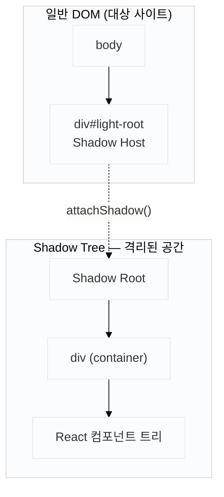

Light는 경제 뉴스 속 금융 용어를 자동 감지해 툴팁으로 보여주는 Chrome 확장 프로그램입니다. 콘텐츠 스크립트에서 React 컴포넌트를 타사 페이지에 주입하는 구조입니다.

처음 구현은 단순했습니다.

```tsx
const container = document.createElement("div");
document.body.appendChild(container);
ReactDOM.createRoot(container).render(<TooltipLayer />);
```

로컬 테스트에서는 잘 동작합니다. 그런데 실제 네이버 뉴스에서 실행하면 툴팁 폰트가 대상 사이트 폰트로 바뀌고, z-index가 묻혀 다른 요소 뒤에 숨고, 레이아웃이 완전히 무너졌습니다.

내가 만든 컴포넌트를 남의 사이트 DOM에 올리는 순간, **타사 사이트의 CSS가 내 컴포넌트를 오염시키거나 반대로 내 CSS가 타사 레이아웃을 망가뜨리는** 충돌이 생깁니다. 이 충돌은 한 번에 해결되지 않고 3단계 장벽으로 나타났습니다.

## CSS가 침범하는 이유

브라우저는 DOM 트리 전체에 스타일시트를 적용합니다. 익스텐션이 주입한 `div`도 대상 사이트 DOM의 자식이므로, 사이트의 `*`, `body`, `div` 등 글로벌 셀렉터가 그대로 영향을 미칩니다.

```css
/* 대상 사이트 CSS — 전혀 무관한 컴포넌트에도 적용됨 */
* {
  box-sizing: border-box;
  font-family: "Noto Sans KR", sans-serif;
}
div {
  position: relative;
}
```

특히 오래된 커머스 사이트는 전역 스타일이 공격적입니다. `font-size`, `line-height`, `color`를 `*` 셀렉터로 강제하는 경우가 많습니다.

## Shadow DOM: 격리된 독립 트리

Shadow DOM은 브라우저가 DOM 트리 안에 만들 수 있는 **격리된 하위 트리**입니다. 외부 CSS 선택자가 Shadow Root 안쪽 요소를 대상으로 삼지 못하고, Shadow Root 안에서 정의한 스타일도 외부로 새어 나가지 않습니다.

구성 요소는 세 가지입니다.

| 용어                | 역할                                                               |
| ------------------- | ------------------------------------------------------------------ |
| **Shadow Host**     | 일반 DOM에 존재하는 평범한 요소. Shadow Tree를 품고 있는 겉모습    |
| **Shadow Root**     | `attachShadow()`로 생성되는 Shadow Tree의 시작점                   |
| **Shadow Boundary** | Shadow Root와 외부 DOM 사이의 경계. CSS 선택자가 이 선을 넘지 못함 |



일반 DOM 안의 요소는 대상 사이트 CSS에 영향을 받습니다. Shadow Root 아래의 요소는 받지 않습니다. 이 경계를 **Shadow Boundary**라고 부릅니다.

## 1단계 — CSS 선택자 격리: attachShadow

`attachShadow({ mode: 'open' })`으로 Shadow Root를 생성하고 그 안에 container를 넣습니다. React는 container를 루트로 삼아 렌더링합니다.

```tsx
const host = document.createElement("div");
document.body.appendChild(host);

const shadowRoot = host.attachShadow({ mode: "open" });

const container = document.createElement("div");
shadowRoot.appendChild(container);

ReactDOM.createRoot(container).render(<TooltipLayer />);
```

대상 사이트의 `*`, `div` 선택자는 Shadow Boundary를 넘지 못합니다. 1단계 장벽이 해결됩니다.

## 2단계 — 상속 속성 차단: `:host { all: initial }`

1단계로 선택자 침범은 막았지만, `font-family`, `color`, `line-height` 같은 **상속 속성(inherited properties)** 은 Shadow Boundary를 넘어 전파됩니다. CSS 선택자가 아닌 부모-자식 상속 메커니즘이기 때문입니다.

`:host { all: initial }`로 Shadow Host 자체에서 모든 상속을 끊습니다. 또한 `rem` 단위는 문서 루트(`html`)의 `font-size`에 영향을 받으므로, 대상 사이트가 `html { font-size: 62.5% }`를 쓰는 경우를 대비해 기준값을 명시합니다.

```css
:host {
  all: initial; /* 상속 속성 초기화 */
  display: block;
  font-family: sans-serif;
  font-size: 16px; /* rem 기준값 명시 */
}
```

## 3단계 — CSS-in-JS 주입 위치: Emotion createCache

2단계까지 적용했더니 이번엔 Emotion 스타일이 사라졌습니다. Emotion은 기본적으로 `<head>`에 `<style>` 태그를 삽입합니다. Shadow DOM 안 컴포넌트에서 Emotion CSS를 쓰면 스타일 태그는 `<head>`에 붙고, 컴포넌트는 Shadow Root 안에 있습니다.

`<head>`의 스타일시트는 Shadow Root 안으로 들어가지 않습니다. CSS가 적용되지 않아 스타일 없는 날것의 HTML이 됩니다.

`createCache`의 `container` 옵션에 Shadow Root를 넘기면 Emotion이 Shadow Root 안에 `<style>` 태그를 삽입합니다. CSS와 컴포넌트가 같은 Shadow Root 안에 있으므로 정상적으로 적용됩니다.

```tsx
import createCache from "@emotion/cache";
import { CacheProvider } from "@emotion/react";

const shadowCache = createCache({
  key: "light",
  container: shadowRoot, // <style> 태그가 여기 붙는다
});

ReactDOM.createRoot(container).render(
  <CacheProvider value={shadowCache}>
    <TooltipLayer />
  </CacheProvider>,
);
```

## 전체 마운트 코드

```tsx
// src/content/mount.tsx
import React from "react";
import ReactDOM from "react-dom/client";
import createCache from "@emotion/cache";
import { CacheProvider } from "@emotion/react";
import { TooltipLayer } from "./TooltipLayer";

export function mountTooltipLayer() {
  const host = document.createElement("div");
  host.id = "light-extension-root";
  document.body.appendChild(host);

  const shadowRoot = host.attachShadow({ mode: "open" });

  const container = document.createElement("div");
  shadowRoot.appendChild(container);

  const emotionCache = createCache({
    key: "light",
    container: shadowRoot,
  });

  ReactDOM.createRoot(container).render(
    <CacheProvider value={emotionCache}>
      <TooltipLayer />
    </CacheProvider>,
  );
}
```

## 이벤트 retargeting — 리스너는 document에 붙입니다

`<span data-light>` 위에 마우스를 올리면 툴팁이 떠야 합니다. Shadow Root 안에 리스너를 붙이면 될 것 같지만, 이벤트가 Shadow Boundary를 넘는 순간 `event.target`이 Shadow Host(`div#light-root`)로 교체됩니다(retargeting). 어떤 span 위에 마우스가 있는지 알 수 없게 됩니다.

`document`에 리스너를 붙이고 Shadow Root 안의 React 상태를 업데이트하는 방식으로 이 문제를 피합니다. 이벤트는 일반 DOM에서 감지하고 렌더링만 Shadow Root 안에서 처리합니다.

```ts
// 이벤트 감지 — Shadow Root 바깥
document.addEventListener("mouseover", (e) => {
  const target = e.target as HTMLElement;
  const span = target.closest("[data-light]");
  if (span) {
    tooltipStore.show(span.getBoundingClientRect());
  }
});
```

```tsx
// 렌더링 — Shadow Root 안
function TooltipLayer() {
  const { visible, rect } = useTooltipStore();
  if (!visible) return null;
  // getBoundingClientRect()는 뷰포트 기준 좌표를 반환한다.
  // position: fixed 없이 top/left를 쓰면 스크롤 위치에 따라 어긋난다.
  return (
    <Tooltip style={{ position: "fixed", top: rect.top, left: rect.left }} />
  );
}
```

## mode: 'open' vs 'closed'

`attachShadow`의 `mode` 옵션은 두 가지입니다.

| mode       | 설명                                      |
| ---------- | ----------------------------------------- |
| `'open'`   | `host.shadowRoot`로 외부에서 접근 가능    |
| `'closed'` | `host.shadowRoot`가 null — 외부 접근 불가 |

익스텐션 콘텐츠 스크립트에서는 `'open'`이 디버깅하기 편합니다. DevTools에서 Shadow Root 내부 요소를 선택하고 스타일을 검사할 수 있습니다. 보안상 중요한 UI라면 `'closed'`를 쓰지만, 콘텐츠 스크립트 수준에서 클로즈드 모드가 제공하는 보안 이점은 제한적입니다.

## 회고

처음에는 `attachShadow` 하나면 CSS 문제가 끝날 줄 알았습니다. 그런데 수정할 때마다 다음 레이어가 드러났습니다.

Shadow DOM으로 선택자 오염을 막았더니 상속 속성이 여전히 넘어왔습니다. `:host { all: initial }`로 초기화했더니 Emotion 스타일이 사라졌습니다. `createCache`로 삽입 위치를 바꿨더니 이번엔 이벤트 retargeting 문제가 생겼습니다.

돌아보면 격리가 필요한 레이어가 처음부터 세 곳이었습니다.

| 레이어 | 문제 | 해결 |
| --- | --- | --- |
| DOM 구조 | 전역 CSS 선택자 침범 | `attachShadow`로 선택자 격리 |
| CSS 상속 | 상속 속성이 Boundary를 넘어 전파 | `:host { all: initial }`로 차단 |
| CSS-in-JS 런타임 | Emotion이 `<head>`에 스타일 삽입 | `createCache`로 주입 위치 변경 |

> "격리"를 구현할 때 무엇을 격리하는지를 먼저 물어야 한다. 선택자인지, 상속인지, 런타임 동작인지. 한 단어로 부르는 격리가 실제로는 여러 레이어에 걸쳐 있을 때, 빠진 레이어가 버그가 된다.
