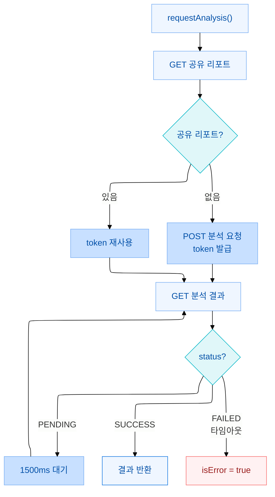

AI 분석 기능을 구현할 때 비동기 흐름이 단순하지 않았습니다. 일반적인 API는 요청하면 결과가 즉시 돌아오지만, AI 분석은 서버에서 처리를 완료하기까지 수 초가 걸립니다.

분석 버튼을 누르면 서버 처리가 완료될 때까지 로딩 상태를 유지하다가, 결과가 준비되면 화면에 표시됩니다.


## 공유 리포트를 도입하게 된 이유

AI 모델의 성능이 올라갈수록 그에 따르는 API 비용도 기하급수적으로 늘어납니다. 예를 들어 이번에 도입한 `gpt-5.6-terra` 모델은 기존 `gpt-4o-mini`와 비교했을 때 입력 비용은 **16.7배**, 출력 비용은 무려 **25배**에 달합니다.

* **단순 계산 시:** 분석 1회당 입력 비용만 약 **$0.50**
* **실제 리스크:** 만약 조직원 100명이 각자 대시보드에 들어와 아무 생각 없이 분석 버튼을 누른다면? 서버 비용이 순식간에 100배로 폭등하게 됩니다.

하지만 **같은 조직(org) 안에서는 분석 대상 데이터가 같기 때문에 AI가 만들어내는 결과물도 동일**합니다. 굳이 사람마다 따로 비용을 내며 중복 연산을 할 이유가 없습니다.

이를 해결하기 위해 백엔드 팀과 함께 구조를 개편했습니다. 분석을 새로 요청하는 `POST` API와 완성된 결과를 조회하는 `GET` API를 완전히 분리하고, "이미 우리 조직에 공유된 최근 리포트가 존재한다면, 새로운 POST 요청 없이 기존 결과를 그대로 가져다 쓴다"는 공유 리포트 로직을 설계했습니다.

비용도 아끼고 속도도 챙기는 일석이조의 구조였지만, 프론트엔드에서 처리해야 할 비동기 흐름은 한층 더 까다로워졌습니다.

## 전체 흐름

1. POST로 임시 `accessToken`을 발급받는다
2. 그 토큰으로 GET <TermAnnotation def="서버에 일정 간격으로 반복 요청해 처리 완료 여부를 확인하는 방식. 서버가 결과를 알려주는 대신 클라이언트가 주기적으로 상태를 확인한다.">폴링</TermAnnotation>을 한다 — `status`가 `"PENDING"`(처리 중)이면 1500ms마다 재요청하고, `"SUCCESS"`가 되면 중단
3. 같은 조직에 공유 리포트가 이미 있으면 POST 없이 재사용한다

공유 리포트가 있으면 POST를 건너뛰고 기존 `accessToken`으로 바로 폴링을 시작합니다. 없으면 POST로 신규 토큰을 발급받은 뒤 즉시 첫 GET을 발사하고, 이후 1500ms 간격으로 폴링합니다.



## refetchInterval 동적 제어

`refetchInterval`은 TanStack Query가 일정 간격마다 자동으로 쿼리를 다시 실행하는 옵션입니다. 숫자를 전달하면 고정 주기로 반복되고, 함수를 전달하면 매 재요청 직전에 실행되어 간격을 동적으로 결정할 수 있습니다.

> 함수가 숫자를 반환하면 해당 ms 후에 재요청하고, `false`를 반환하면 자동 재요청을 멈춘다.

폴링 조건마다 다른 동작이 필요했기 때문에 함수를 전달했습니다.

```ts
const reportQuery = useCoreQuery(
  QUERY_KEYS.ai.report(provider, orgId),
  () => getAiReportByAccessToken(accessToken!),
  {
    enabled: !!accessToken,
    staleTime: 0,
    gcTime: AI_REPORT_GC_TIME_MS,       // 언마운트 후 5분 캐시 유지
    refetchInterval: (query) => {
      const status = query.state.data?.status;
      if (status !== "PENDING") return false;                                     // 1. 완료·실패 → 중단
      if (pollStartedAt && Date.now() - pollStartedAt > MAX_POLL_MS) return false; // 2. 타임아웃 초과 → 중단
      return POLL_INTERVAL_MS;                                                    // 3. PENDING 유지 → 1500ms 후 재요청
    },
  },
);
```

`status`가 `"PENDING"`이 아니면 폴링을 중단하고, 타임아웃을 초과해도 중단합니다. `refetchInterval: false`를 반환하면 TanStack Query는 자동 재패치를 멈춥니다.

POST 직후 첫 GET을 1500ms 기다리지 않고 즉시 발사하기 위해 `onSuccess`에서 `queryClient.fetchQuery()`를 명시적으로 호출했습니다.

## 훅으로 흐름 격리하기

훅 없이 컴포넌트에서 직접 구현하면 `accessToken` 상태, POST 결과, 폴링 쿼리, 타임아웃 타이머, 에러 분기가 UI 코드와 한 파일에 얽힙니다. `useAiAnalysisReport` 하나로 감싸면 컴포넌트는 UI에만 집중할 수 있습니다.

```ts
const { reportData, requestAnalysis, isLoading, isError, loadingMessage } =
  useAiAnalysisReport("ALL");
```

`requestAnalysis()`를 한 번 호출하면 공유 리포트 조회 → POST → 폴링이 순서대로 처리됩니다. 컴포넌트는 `isLoading`, `isError`, `reportData`만 읽으면 됩니다.

## 캐시 파편화를 막는 쿼리 키 재설계

초기에는 쿼리 키를 `QUERY_KEYS.ai.report(provider, accessToken)`으로 설정했습니다. 이후 백엔드와 협의해 리포트를 조직 단위로 공유·재사용하는 구조로 설계가 변경되면서 쿼리 키도 함께 재검토했습니다.

accessToken은 임시 접근 키라 재발급마다 값이 바뀝니다. 토큰이 바뀔 때마다 새 쿼리 키가 생성되어 기존 캐시를 읽지 못하고 폴링이 새로 시작됩니다. 조직별 공유 구조에서는 캐시 식별자도 조직 단위여야 합니다.

```ts
// Before: 토큰 재발급 → 키 변경 → 캐시 파편화
QUERY_KEYS.ai.report = (provider, accessToken) =>
  ["ai", "report", provider, accessToken];

// After: orgId 기준 → 안정적인 캐시 키
QUERY_KEYS.ai.report = (provider, orgId) =>
  ["ai", "report", provider, orgId];
```

캐시의 의미 단위는 "조직의 AI 리포트"입니다. 식별자는 토큰이 아니라 `orgId`가 맞습니다. 쿼리 키를 무엇으로 잡을지는 "이 데이터를 식별하는 기준이 무엇인가"를 먼저 생각해야 합니다.

## gcTime과 staleTime 조합

```ts
gcTime: AI_REPORT_GC_TIME_MS,  // 언마운트 후 5분 캐시 유지
staleTime: 0,                   // 마운트 시 항상 백그라운드 갱신
```

<TermAnnotation def="컴포넌트가 언마운트된 뒤 캐시를 메모리에 유지하는 시간으로, 이 안에 재마운트되면 서버 요청 없이 캐시를 재사용한다.">gcTime</TermAnnotation>을 5분으로 설정한 이유는 같은 조직 리포트를 짧은 시간 내 재방문하면 API 호출 없이 캐시를 재사용하기 위해서입니다. `staleTime: 0`은 그와 동시에 마운트 시점에 서버 데이터가 달라졌는지 항상 확인합니다.

## 회고

복잡한 비동기 흐름을 단일 훅으로 감싸고, 쿼리 키를 데이터의 의미 단위(조직)로 잡은 것이 이 작업의 핵심이었습니다. 공유 리포트 구조 덕분에 AI API 호출 횟수를 줄일 수 있었고, `refetchInterval`에 함수를 전달해 폴링을 조건에 따라 동적으로 제어했습니다.
