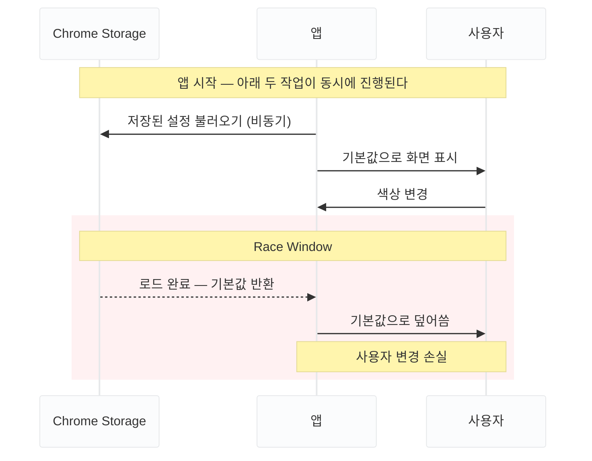
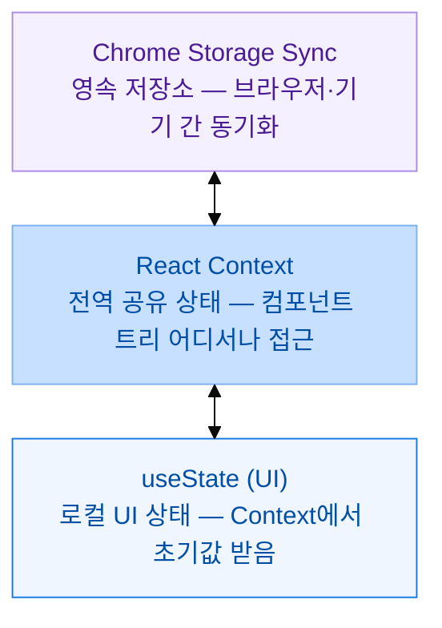

light 확장 프로그램은 사용자 설정(카테고리, 하이라이트 색상, API 키)을 Chrome Storage에 저장합니다. `localStorage`와 달리 페이지가 바뀌어도 설정이 유지되고 기기 간 동기화도 되지만, 읽기·쓰기가 모두 비동기입니다. 개발 중 설정을 변경하면 가끔 무시되는 현상이 있었습니다. 하이라이트 색상을 바꿨는데 새로고침하면 기본값으로 돌아오기도 했습니다. 재현 조건을 찾다가 빠르게 설정을 바꿀 때만 발생한다는 것을 알았습니다.

## 문제: 비동기 초기화 중 설정이 덮어씌워진다

Chrome Storage는 데이터를 불러올 때 결과를 즉시 반환하지 않는 비동기 API입니다. `chrome.storage.sync.get()`을 호출하면 데이터가 올 때까지 실행을 멈추는 것이 아니라, 일단 다음 코드로 넘어가고 데이터가 준비되면 <TermAnnotation def="비동기 작업이 완료된 뒤 실행되도록 미리 전달해두는 함수. chrome.storage.sync.get()은 데이터 로드가 끝나면 콜백을 호출한다.">콜백 함수</TermAnnotation>를 실행합니다.

덕분에 앱이 Storage 응답을 기다리느라 멈추지 않고 빠르게 렌더링됩니다. 반대로 말하면, 초기화가 끝나기 전에도 사용자는 화면을 자유롭게 조작할 수 있습니다.

앱이 처음 마운트되는 아주 짧은 순간, 두 가지 일이 동시에 진행됩니다.

- Storage에서 이전 설정값을 불러오는 중 (비동기 요청 진행 중)
- 사용자가 화면을 보고 설정을 변경하는 중

두 작업이 동시에 진행되면서 완료 순서에 따라 결과가 달라지는 현상을 <TermAnnotation def="두 작업이 동시에 실행될 때 완료 순서에 따라 결과가 달라지는 버그 패턴. 타이밍에 따라 발생 여부가 결정되어 재현이 어렵다.">**Race Condition**</TermAnnotation>이라고 합니다. 여기서는 "Storage 초기화"와 "사용자의 설정 변경"이 서로 엇갈립니다.



마운트에서 Storage 초기화 완료까지는 수십 ms에 불과합니다. 대부분의 경우 발생하지 않지만, 확장 프로그램이 처음 로드될 때 설정 화면이 빠르게 열리면 재현됩니다.

## 해결: isLoadedRef로 초기화 전 저장 차단

상태를 세 계층으로 분리했습니다.



초기화 완료 전 Storage에 저장되는 것을 차단하는 가드를 추가했습니다. `isLoadedRef`가 `true`가 되기 전까지 `settings` 변경이 Storage에 반영되지 않습니다.

```ts
// useSettingsStorage.ts

const [settings, setSettings] = useState<Settings>(DEFAULT_SETTINGS)
const isLoadedRef = useRef(false)

// 1단계: Chrome Storage에서 설정 로드
useEffect(() => {
  chrome.storage.sync.get(SETTINGS_KEY, result => {
    if (result[SETTINGS_KEY]) {
      setSettings(result[SETTINGS_KEY] as Settings)
    }
    isLoadedRef.current = true // 초기화 완료 표시
  })
}, [])

// 2단계: settings가 바뀔 때마다 Storage에 저장
useEffect(() => {
  if (!isLoadedRef.current) return // 초기화 전이면 저장 차단
  chrome.storage.sync.set({ [SETTINGS_KEY]: settings })
}, [settings])
```

`settings`가 바뀔 때마다 실행되는 `useEffect`에 가드를 뒀습니다. 초기화 완료 전에 발생하는 `settings` 변경은 Storage에 쓰이지 않고 무시됩니다.

### useState 대신 useRef를 쓴 이유

`useState`는 값이 바뀌면 React가 감지해 컴포넌트를 다시 렌더링합니다. `useRef`는 `.current`에 값을 저장하는데, 이 값이 바뀌어도 리렌더가 발생하지 않습니다.

`isLoadedRef`를 `useState`로 바꾸면 Storage 콜백 안에서 두 개의 상태 변경이 일어납니다.

```ts
// useState 사용 시
const [isLoaded, setIsLoaded] = useState(false)

chrome.storage.sync.get(SETTINGS_KEY, result => {
  setSettings(result)   // 리렌더 ①
  setIsLoaded(true)     // 리렌더 ②
})
```

```ts
// useRef 사용 시
const isLoadedRef = useRef(false)

chrome.storage.sync.get(SETTINGS_KEY, result => {
  setSettings(result)         // 리렌더 ①
  isLoadedRef.current = true  // 리렌더 없음
})
```

**`isLoaded`는 화면에 표시할 필요가 없는 내부 플래그입니다.** `useEffect` 가드 역할만 하면 되므로, 리렌더를 유발하는 `useState`보다 `useRef`가 더 적합합니다.

## 정리

| 방식 | Race Condition | 리렌더 비용 |
|------|---------------|------------|
| `isLoaded` useState | 방지 | 초기화 시 2회 |
| **isLoadedRef 가드** | 방지 | 초기화 시 1회 |

`isLoadedRef`는 동기적으로 업데이트되지 않으므로, 극단적으로 빠른 연속 클릭에서는 여전히 race 가능성이 있습니다. 실제 사용 환경에서는 마운트~초기화가 수십 ms이고 그 사이에 설정을 변경하는 경우가 없어 문제가 되지 않았습니다.

Chrome extension content script는 페이지 새로고침마다 재실행됩니다. 이 가드가 없으면 사용자 설정이 조용히 손실됩니다.
