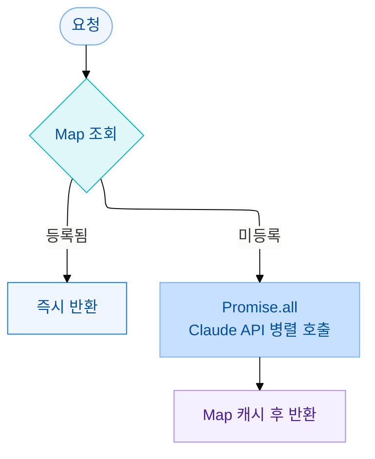

light는 기사에서 금융 용어를 감지해 툴팁을 보여주는 확장 프로그램입니다. PER·PBR·ETF처럼 자주 쓰이는 금융 용어 54개를 `terms.json`에 등록해 무료로 제공합니다. 금융 용어는 수천 개에 달하기 때문에 전부 직접 등록하는 것은 불가능합니다. 사용자가 Claude API 키를 입력하면 미등록 용어도 AI가 분석해 설명을 생성합니다.

설정 화면에서 Claude API 키를 입력하면 미등록 용어 분석이 활성화됩니다.


등록 용어는 `terms.json`에서 즉시, 미등록 용어는 Claude가 생성한 설명이 툴팁에 표시됩니다.

처음에는 모든 용어 후보를 Claude API에 전달했습니다. 등록 용어도, 미등록 용어도 구분 없이 함께 보냈습니다. 기사 하나에 용어가 10개 감지되면 API를 10번 호출하는 구조였습니다.

## 등록 용어까지 API에 보내는 것은 낭비다

기사에서 감지된 용어 중 대부분은 이미 `terms.json`에 있는 등록 용어입니다. 이 용어들은 설명이 이미 작성되어 있는데 매번 API를 호출해 다시 설명을 받아오는 것은 비용 낭비입니다. 1인 프로젝트에서 Claude API 비용은 직접 부담이 됩니다.

또한 10개 용어를 직렬로 처리하면 총 응답 시간은 각 API 호출 시간의 합입니다. 용어 하나당 평균 500ms라면 10개에 5,000ms입니다. 툴팁은 즉각성이 중요한 기능이어서 5초 대기는 UX를 망칩니다.

## 2단계 분기: Map 조회 → API 병렬 처리

서버 시작 시 `terms.json`을 Map으로 로드해 둡니다. Map은 내부적으로 해시 테이블로 동작합니다. 키를 해시 함수로 변환해 값의 위치를 바로 찾기 때문에, 등록 용어가 100개든 10,000개든 조회 시간이 같습니다. 이것이 O(1)입니다.

plain object(`{}`)도 동일하게 O(1)이지만, `"toString"`이나 `"constructor"` 같은 프로토타입 키와 충돌할 위험이 있습니다. Map은 순수한 키-값 저장소로만 동작하고 `.has()`로 존재 여부를 명확하게 확인할 수 있어 선택했습니다.

요청이 들어오면 등록 여부를 먼저 확인하고, 미등록 용어만 Claude API로 보냅니다.



```ts
// light-server/src/server.ts

// 서버 시작 시 1회 로드
const termMap = new Map<string, ITermData>(
  Object.entries(require("./terms.json"))
);

app.post("/api/terms", async (req, res) => {
  const { terms } = req.body as { terms: string[] };

  const results: ITermResult[] = [];
  const unknownTerms: string[] = [];

  // 1단계: Map 조회 O(1)
  for (const term of terms) {
    if (termMap.has(term)) {
      results.push({ term, data: termMap.get(term)!, source: "registry" });
    } else {
      unknownTerms.push(term);
    }
  }

  if (unknownTerms.length === 0) {
    return res.json({ results });
  }

  // 2단계: 미등록 용어만 Claude API 병렬 처리
  const aiResults = await Promise.all(
    unknownTerms.map(async (term) => {
      const response = await anthropic.messages.create({
        model: "claude-haiku-4-5-20251001",
        max_tokens: 200,
        messages: [{ role: "user", content: `금융 용어 "${term}"을 2-3문장으로 설명해주세요.` }],
      });
      const data = {
        description: response.content[0].type === "text" ? response.content[0].text : "",
        source: "ai" as const,
      };

      // AI 처리 결과를 Map에 캐시 → 다음 요청은 API 호출 없음
      termMap.set(term, data);

      return { term, data };
    })
  );

  res.json({ results: [...results, ...aiResults] });
});
```

## 직렬 처리와 병렬 처리의 차이

`Promise.all`은 배열의 모든 Promise를 동시에 실행합니다. 미등록 용어 3개를 처리할 때 직렬 처리는 3개를 순서대로 기다리므로 총 시간이 각 호출 시간의 합이 됩니다. `Promise.all`은 3개가 동시에 실행되어 가장 오래 걸리는 것 하나를 기다립니다.

Node.js는 싱글 스레드지만 Claude API 호출은 네트워크 I/O입니다. 응답을 기다리는 시간 동안 이벤트 루프는 블로킹되지 않아 다음 요청을 바로 시작할 수 있습니다. CPU 연산이라면 병렬화가 불가능하지만, 네트워크 요청처럼 대기가 대부분인 작업은 `Promise.all`이 실질적으로 동시 처리와 같은 효과를 냅니다.

```ts
// 직렬: 총 시간 = 500ms + 500ms + 500ms = 1,500ms
for (const term of unknownTerms) {
  const result = await callClaudeApi(term);
}

// 병렬: 총 시간 = max(500ms, 500ms, 500ms) ≈ 500ms
const results = await Promise.all(unknownTerms.map(callClaudeApi));
```

Map에 캐시하므로 같은 미등록 용어가 다시 요청되면 API를 호출하지 않습니다. 시간이 지날수록 API 호출 비율은 줄어듭니다.

## 프롬프트 설계

Claude에 전달하는 프롬프트는 단순합니다.

```ts
`금융 용어 "${term}"을 2-3문장으로 설명해주세요.`
```

"2-3문장"으로 제한한 이유는 툴팁 표시 공간이 좁기 때문입니다. 더 긴 설명을 받아도 UI에서 잘리므로 핵심만 담은 짧은 설명이 적합합니다. `max_tokens: 200`도 이 제약에 맞춰 설정한 값입니다.

프롬프트에 "금융 용어"라는 맥락을 명시한 것도 의도적입니다. 같은 단어라도 맥락이 없으면 Claude는 일반적인 의미로 답할 수 있습니다. "금융 용어"라는 전제를 주면 금융 분야 해석을 기준으로 설명을 생성합니다.

## Claude Haiku를 선택한 이유

Claude 모델은 Haiku → Sonnet → Opus 순으로 추론 능력과 비용이 높아집니다. 과제의 복잡도에 맞는 모델을 선택하는 것이 비용 최적화의 기본입니다.

금융 용어를 2-3문장으로 설명하는 것은 정해진 형식에 맞게 정보를 출력하는 작업입니다. 다단계 추론이나 코드 생성처럼 Sonnet·Opus가 필요한 과제가 아닙니다. 툴팁은 즉각성이 중요하고 1인 프로젝트 예산에서 비용도 무시할 수 없어 Haiku가 가장 적합한 선택이었습니다.

<Callout type="tip">
`Promise.all`은 하나라도 reject되면 전체가 실패합니다. 일부 용어 API 호출이 실패해도 나머지 결과를 반환하려면 `Promise.allSettled`로 교체하는 것이 더 안전합니다.
</Callout>

## 정리

| 방식 | 등록 용어 비용 | 미등록 용어 응답 시간 | 인프라 |
|------|--------------|----------------------|--------|
| 모든 용어 AI 처리 | 낭비 | 직렬 × 용어 수 | 없음 |
| Redis 캐시 | 절감 | 병렬 | 추가 필요 |
| **Map 캐시 + Promise.all** | 절감 | 병렬 | 없음 (인메모리) |

등록 용어는 Map에서 O(1)로 반환하고 미등록 용어만 병렬 처리하는 구조로, 추가 인프라 없이 API 비용과 응답 속도 두 가지를 함께 개선했습니다.
