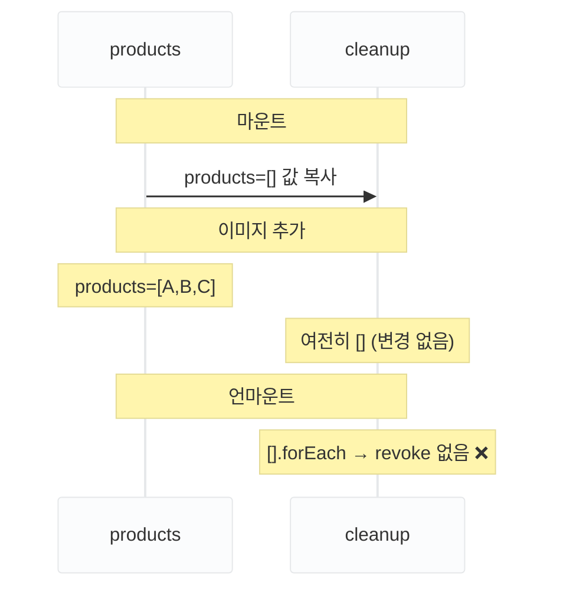
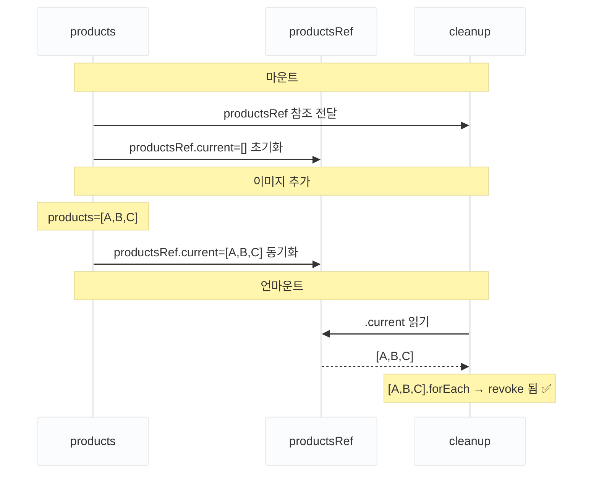

Roome의 레퍼런스 업로드 페이지에서 파일 선택 → 미리보기 → 다른 파일로 교체를 반복하면 메모리가 계속 증가하는 것을 Chrome DevTools Memory 탭에서 확인했습니다. 이전 이미지가 화면에서 사라져도 메모리는 줄어들지 않았습니다. 원인은 미리보기에 사용한 [`URL.createObjectURL()`](https://developer.mozilla.org/ko/docs/Web/API/URL/createObjectURL_static)이 생성한 Blob URL을 해제하지 않은 것이었습니다.


## Object URL을 revoke하지 않으면 GC가 회수하지 못한다

`URL.createObjectURL(file)`은 파일의 실제 데이터(<TermAnnotation def="Binary Large Object. 이미지·동영상처럼 이진 데이터를 다루는 브라우저 내장 객체. input file로 선택한 File 객체도 Blob을 상속한다.">Blob</TermAnnotation>)를 브라우저 메모리(RAM)에 올리고, 그 위치를 가리키는 가상의 URL(`blob:http://...`)을 반환합니다. 일반 URL과 달리 서버가 아닌 **브라우저 메모리에 실제 파일 데이터가 올라가 있습니다.** [`URL.revokeObjectURL()`](https://developer.mozilla.org/ko/docs/Web/API/URL/revokeObjectURL_static)로 명시적으로 해제하지 않으면 브라우저는 URL이 아직 유효하다고 인식해 Garbage Collector가 해당 Blob을 회수하지 못합니다. 탭을 닫을 때까지 메모리가 점유된 채로 유지됩니다.

이미지를 교체할 때마다 새 URL이 생성되는데, 이전 URL을 <TermAnnotation def="URL의 유효성을 취소·해제하는 것. URL.revokeObjectURL()을 호출하면 브라우저가 해당 Blob URL을 더 이상 유효하지 않다고 인식하고, 연결된 메모리를 해제할 수 있게 된다.">revoke</TermAnnotation>하지 않으면 사용하지 않는 Blob이 메모리에 계속 쌓입니다. 레퍼런스 업로드 페이지는 메인 이미지 1개 + 연관 제품 이미지 배열(N개)을 다루므로 누수 규모가 더 컸습니다.

## 단일 이미지는 useEffect cleanup으로 처리

단일 이미지는 `useEffect`의 cleanup 함수가 자연스럽게 revoke 타이밍을 처리합니다. `mainImage`가 변경될 때마다 이전 effect의 cleanup이 실행됩니다.

```ts
useEffect(() => {
  if (!mainImage) { setMainImageUrl(undefined); return; }

  const url = URL.createObjectURL(mainImage);
  setMainImageUrl(url);

  // cleanup: mainImage가 바뀌거나 언마운트 시 이전 URL revoke
  return () => URL.revokeObjectURL(url);
}, [mainImage]);
```

`mainImage`가 새 파일로 바뀌면 이전 effect의 cleanup이 먼저 실행되어 이전 URL이 revoke됩니다. 그 다음 새 effect가 실행되어 새 URL을 생성합니다. 언마운트 시에도 cleanup이 실행됩니다.

## 배열 이미지의 클로저 함정을 useRef로 우회

배열 이미지는 단일 이미지와 달리 단순히 `useEffect` cleanup에 revoke를 넣는 것으로 해결되지 않습니다. 세 가지 시도를 순서대로 살펴보겠습니다.

### deps=[]이면 cleanup이 빈 배열을 순회한다

`useEffect` 안에 작성한 함수는 **effect가 실행된 시점의 변수를 기억**합니다. 나중에 그 변수가 바뀌어도 cleanup은 처음 기억한 값을 그대로 사용합니다.



마운트 시점에 cleanup이 `products`의 **값([])**을 복사해 가져갑니다. 이후 `products`가 `[A,B,C]`로 바뀌어도 cleanup에게는 아무 신호도 전달되지 않습니다. 언마운트 시 cleanup이 실행되면 처음 복사한 빈 배열만 갖고 있어 revoke가 일어나지 않습니다.

```ts
// ❌ cleanup이 항상 빈 배열을 순회
useEffect(() => {
  return () => {
    products.forEach((p) => URL.revokeObjectURL(p.imageUrl));
  };
}, []);
```

### deps=[products]이면 화면에 표시 중인 이미지가 깨진다

`products`를 deps에 추가하면 cleanup이 최신 값을 읽을 수 있습니다. 그런데 `products`가 **바뀔 때마다** 이전 effect가 cleanup을 실행합니다.

```text
① 이미지 A 추가 → products = [A]
② effect 재실행 → 직전 cleanup 실행 → products = [A] revoke
③ 이미지 A는 아직 화면에 표시 중 → URL이 끊겨 이미지가 깨짐
```

언마운트가 아닌 "제품을 추가할 때마다" revoke가 일어나므로 미리보기가 즉시 깨집니다.

### useRef로 cleanup에 최신값을 전달한다

`useRef`는 렌더마다 새로 생성되지 않고 **항상 같은 객체**를 반환합니다. cleanup은 이 ref 객체 자체를 기억합니다. 매 렌더마다 `productsRef.current = products`로 동기화해두면, cleanup이 실행되는 시점에 `.current`를 읽어 항상 최신 `products`를 얻습니다.



cleanup이 값이 아닌 **productsRef 객체 자체**를 받습니다. 이미지가 추가될 때 `products → productsRef.current` 동기화가 일어나고, cleanup은 같은 객체를 통해 `.current`를 조회하므로 항상 최신 배열을 읽습니다.

```ts
const productsRef = useRef<RegisteredProduct[]>([]);
productsRef.current = products; // 매 렌더마다 최신값으로 동기화

useEffect(() => {
  return () => {
    // 언마운트 시 모든 제품 이미지 일괄 revoke
    productsRef.current.forEach((p) => {
      if (p.imageUrl) URL.revokeObjectURL(p.imageUrl);
    });
  };
}, []); // deps 비움: 언마운트 시 1회만 실행
```

| | deps=[] | deps=[products] | useRef |
|---|---|---|---|
| cleanup이 읽는 값 | 마운트 시 빈 배열 | 매 변경 시 스냅샷 | 실행 시점 최신값 |
| revoke 타이밍 | 언마운트 (but 빈 배열) | 제품 추가 때마다 | 언마운트 시 |
| 결과 | revoke 안 됨 | 표시 중 이미지 깨짐 | 정상 |

## 트레이드오프

현재 구현은 배열 이미지를 개별 교체할 때 이전 URL을 즉시 revoke하지 않고, 페이지를 벗어날 때 일괄 처리합니다. 이미지가 수십 장 이상이거나 고용량 파일을 반복 교체한다면 교체 즉시 revoke하는 방식이 더 효율적입니다. Roome의 레퍼런스 업로드는 이미지 수가 최대 5장으로 제한되어 있어 일괄 처리로도 메모리 점유량이 미미합니다. **제약 조건을 확인한 뒤 구현 방식을 선택한 것**이지, 일괄 처리가 항상 옳은 방식은 아닙니다.

`productsRef.current = products` 동기화 라인을 제거하면 클로저 함정이 그대로 재현됩니다. 이 한 줄이 패턴 전체를 지탱하므로, 코드를 처음 보는 팀원이 "불필요한 코드"로 오해하지 않도록 이유를 코멘트로 남겨두는 것이 좋습니다.

## 정리

`URL.createObjectURL`을 쓸 때는 항상 revoke 타이밍을 고려해야 합니다. 단일 값은 `useEffect` cleanup이 자연스럽게 처리하고, 배열처럼 deps 처리가 복잡해지는 경우에는 `useRef`로 최신값을 유지하고 언마운트 시 일괄 revoke하는 패턴이 안전합니다.
